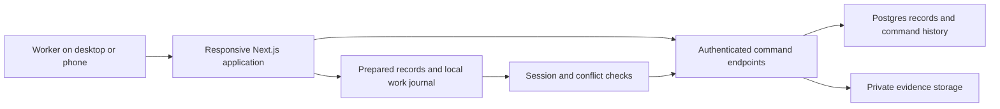

# Building a materials operations application

Public-safe case-study draft, 2026-10-16. This is supporting project evidence,
not a replacement for the Master Plan or a claim of production launch. Review
wording, personal attribution and any screenshots before using it on a portfolio.

## Short introduction

This project turns material receiving, storage, movement and field handoff into
one responsive operations application. Office and warehouse staff can follow a
material record, review its history and evidence, and understand what still needs
attention. Field users have a focused view of assigned work.

The difficult work is preserving trust when a phone loses its connection, two
people act on the same record, a photograph fails to upload, or an old spreadsheet
does not say what its quantity actually means. The implementation makes those
uncertainties visible rather than silently inventing a successful result.

## What exists today

| Area | Evidence-backed description | Acceptance boundary |
| --- | --- | --- |
| Operations UI | Receiving, material locations/movements, verification, Issues, Outbound and Reports have implemented workflows | Local workflow tests do not establish company cutover |
| Shared records | Authenticated Next.js endpoints, Postgres commands, role checks, row-level policies and command receipts | Hosted access evidence is separate from local tests |
| Private evidence | Staged photo uploads and server-side byte/signature/checksum verification | General document editing remains later scope |
| Intermittent connectivity | Prepared records, a scoped IndexedDB journal, photo retention, conflicts and recovery export | Legacy replay remains held; the initial physical-device target is the Android handheld |
| Source preparation | Read-only inventory, bounded inert extraction, provenance and review queues | Extraction is not reviewed import approval or physical stock verification |
| Barcode exploration | Research, a labeling contract, synthetic Code 128 fixtures and a non-mutating test screen | Actual scanner, read range, printing and app integration remain unaccepted |

## How the system fits together

The application is a modular monolith: one deployable application with feature
folders and explicit interfaces. That keeps cross-feature workflows understandable
without introducing independent services before the product needs them. Next.js
and React provide the interface, TypeScript describes contracts, Supabase supplies
Auth/Postgres/private Storage, and IndexedDB preserves prepared device-local work.

Being signed in does not grant every action. The server validates the current
identity and role; database grants, row-level policies and business commands enforce
their own boundaries. Private media is retrieved through authorized access rather
than published as permanent public links. See the current
[architecture overview](../architecture/overview.md) and the implementation paths
it references. Supabase documents the distinction between grants and row policies
in its [RLS guide](https://supabase.com/docs/guides/database/postgres/row-level-security).

## Decisions worth explaining

**A saved action and a synchronized action are different facts.** A worker can
retain supported work locally during a connection gap. Synchronization checks the
account, environment, session and dependencies before replay. A conflict requires
an explicit decision. A command identity allows a lost-response retry to be
recognized instead of creating a second business effect. Automated tests cover
these rules; field acceptance on the primary Android device is still required.
The initial release does not claim physical iPhone acceptance.

**Photographs are part of the operation's evidence.** A successful selection or
upload request does not prove that the intended bytes are stored. The server
checks uploaded evidence before consuming it in a command. This helps preserve
the relationship between the business event and the photograph that supports it.

**Commercial quantities and physical packages need separate models.** The next
domain expansion distinguishes product quantities/UOM from boxes, pallets and
bundles. One handling unit may contain several product lines. This is an accepted
design direction with implementation tickets; the existing package-count model
has not already been migrated to the complete new model.

**A barcode identifies; a person confirms.** The planned scanner opens the
handling-unit record. Receiving, moving or checking out material still requires
an authorized confirmation. An Android handheld runs the application over Wi-Fi;
its supported scanner output supplies the identifier. A beep proves a local read,
not cloud acceptance. The current bench tests that interaction with synthetic
records and no stock-changing connection.

## How we build and track the work

One Master Plan controls priority and acceptance. GitHub issues contain detailed
behavior slices and explicit dependencies. Source findings inform the domain
glossary and specification; consequential tradeoffs receive architecture decision
records. A slice should connect the business rule, storage/command boundary,
interface behavior and appropriate tests.

Changes are checked with lint, strict TypeScript, unit/database tests, production
builds and browser workflows. Review findings become regression tests where a real
behavioral seam exists. Hosted validation, physical-device acceptance and final
production readiness are recorded separately. This keeps a green local test from
being misrepresented as a warehouse-ready product.

AI assistance supports source inspection, research, implementation and validation.
The human product owner supplies operational intent and consequential business
decisions. Portfolio authorship should describe the owner's actual contribution;
this draft does not assert that every line was written manually or that all review
was performed by independent people.

## Evidence to show in a portfolio

- A synthetic receiving/movement demonstration with history and a photo, using
  fixtures rather than customer records.
- The dependency chain from a business requirement to a spec, issue, implementation
  and test result.
- One recovery example showing retained local work and an explicit conflict or
  export decision. Label emulated and physical evidence accurately.
- The barcode compatibility bench alongside its measured limits; replace those
  limits with actual device results only after testing.
- The dependency review as an example of selecting supported patches and explaining
  an unpatched development-tool exception, rather than equating audit exit status
  with the application's entire security posture.

## Claims that still need evidence

Warehouse adoption, operational time savings, inventory accuracy improvement,
financial ROI, production uptime and scanner success rates have not been measured.
Do not publish invented metrics. Company identity, backup/restore acceptance,
opening-stock verification, physical devices and final cutover retain the Master
Plan's gates. Full procurement, document editing and production barcode workflows
remain planned scope.

Before publishing, review personal role/credits, company naming/branding permission
and all screenshots. Use synthetic jobs, people, suppliers and labels. Keep source
documents, private contact details, purchase budgets, internal launch forecasts,
credentials and actual stock out of the portfolio. This document has not been
published to a portfolio website.
